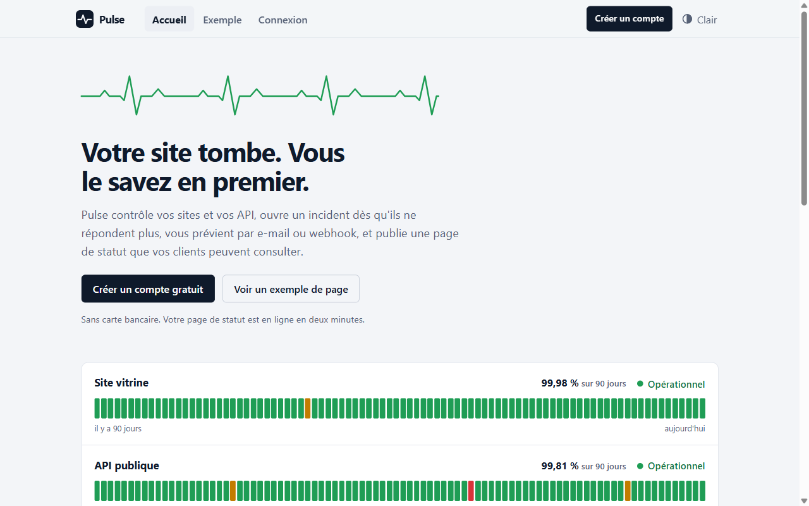

<div align="center">

# Pulse

**Surveillance de disponibilité et pages de statut publiques, en C# / .NET 10 et Blazor.**

[](https://github.com/jordannbell/PULSE/actions/workflows/ci.yml)




</div>

Pulse contrôle à intervalle régulier que vos sites et vos API répondent, ouvre un incident après plusieurs échecs de suite, vous prévient par **e-mail** ou **webhook signé**, et publie une **page de statut** que vos clients peuvent consulter (`/s/votre-nom`), avec la disponibilité sur 90 jours.

C'est un service **multi-clients** : chaque organisation a son compte, ses services, ses alertes et sa page. Les données d'un client ne sont jamais visibles d'un autre.

> **Statut : bêta.** Les formules Gratuite et Pro sont appliquées côté serveur, mais il n'y a aucun paiement : les deux sont gratuites. Une seule instance de l'API est prise en charge.

## Sommaire

- [Fonctionnalités](#fonctionnalités)
- [Démarrage rapide](#démarrage-rapide)
- [Parcours d'un utilisateur](#parcours-dun-utilisateur)
- [Architecture](#architecture)
- [Sécurité](#sécurité)
- [Configuration](#configuration)
- [Alertes](#alertes)
- [API](#api)
- [Tests et vérification](#tests-et-vérification)
- [Feuille de route](#feuille-de-route)
- [Limites connues](#limites-connues)

## Fonctionnalités

- **Surveillance HTTP/HTTPS** planifiée : intervalle, délai maximal et code de réponse attendu par service.
- **Incidents** ouverts après N échecs consécutifs (3 par défaut), fermés au premier succès.
- **Page de statut publique** par organisation : état global, frise de 90 jours par service, incidents regroupés par jour. Elle n'expose jamais les adresses surveillées, et chaque service peut être masqué.
- **Comptes** : inscription, confirmation de l'e-mail, mot de passe oublié, sessions, suppression du compte et de toutes ses données.
- **Alertes par organisation** : e-mail au propriétaire et webhooks signés (JSON, Slack, Discord), avec nouvelles tentatives.
- **Formules** appliquées côté serveur : Gratuite (5 services, un contrôle toutes les 5 min, 1 webhook) et Pro (50 services, 30 s, 5 webhooks).
- **Interface en français**, thème clair, sombre ou automatique, utilisable au clavier et sur mobile (390 px). Aucune requête vers un service tiers (ni polices, ni statistiques).
- Purge automatique des mesures au-delà de 90 jours.

## Démarrage rapide

Prérequis : [SDK .NET 10](https://dotnet.microsoft.com/download).

```bash
# Terminal 1 : l'API (http://localhost:5080)
dotnet run --project src/Pulse.Api --launch-profile http

# Terminal 2 : le site (http://localhost:5090)
dotnet run --project src/Pulse.Web --launch-profile http
```

Ouvre <http://localhost:5090/> et clique sur « Créer un compte ». En développement :

- l'e-mail est confirmé automatiquement (`Pulse:Accounts:AutoVerifyEmail`) et les liens que Pulse enverrait sont écrits dans la console de l'API (`Pulse:Accounts:LogEmailsToConsole`) ;
- les cibles locales sont autorisées (`Pulse:AllowPrivateTargets`), pour pouvoir surveiller `http://localhost:5080/health` ;
- une base vide reçoit l'organisation d'exemple `/s/demo` avec trois services et 90 jours d'historique inventé (`Pulse:SeedDemoData`) ;
- une clé de chiffrement de développement est fournie dans `src/Pulse.Api/appsettings.Development.json`.

**Rien de tout cela ne doit être activé en production.** Pour repartir de zéro, supprime `pulse.db` et relance l'API.

Pour voir une vraie panne et une vraie alerte, lance la cible capricieuse fournie, qui tombe en panne sur commande et reçoit les webhooks :

```bash
dotnet run --project tools/FlakyTarget
# surveille http://localhost:9100/flaky, ajoute un webhook vers http://localhost:9100/hook, puis :
curl -X POST http://localhost:9100/control/500   # panne
curl -X POST http://localhost:9100/control/200   # rétablissement
```

## Parcours d'un utilisateur

1. **Inscription** (`/signup`) : e-mail, mot de passe (10 caractères minimum), nom de l'organisation et adresse de la page de statut. L'utilisateur est connecté tout de suite.
2. **Confirmation de l'e-mail** : un lien valable 24 h. Tant que l'adresse n'est pas confirmée, aucune alerte e-mail n'est envoyée.
3. **Tableau de bord** (`/app`) : ajout, modification et suppression de services, état en direct, derniers contrôles.
4. **Alertes** (`/app/alerts`) : e-mail et webhooks. Le secret d'un webhook n'est affiché qu'une fois. Un bouton envoie une alerte de test.
5. **Page publique** (`/s/{adresse}`) : ce que voient les clients de l'organisation.
6. **Compte** (`/app/account`) : nom, notifications, formule, mot de passe, suppression.
7. **Mot de passe oublié** (`/forgot-password`) : lien à usage unique, valable 1 h, qui ferme toutes les sessions.

Un exemple public avec des données inventées est visible sans compte sur `/s/demo`.

## Architecture

```
src/
  Pulse.Domain          règles métier (organisation, compte, service, mesure, incident)
  Pulse.Application     cas d'usage et ports (comptes, catalogue, vérifications, alertes)
  Pulse.Infrastructure  EF Core + SQLite, sonde HTTP, planificateur, SMTP, chiffrement
  Pulse.Api             API REST minimale (/api/v1)
  Pulse.Contracts       DTO partagés API / site web
  Pulse.Web             site Blazor (accueil, comptes, tableau de bord, pages publiques)
tests/Pulse.Tests       tests unitaires, d'intégration et de l'API
tools/FlakyTarget       cible capricieuse, récepteur de webhooks et faux serveur SMTP
scripts/verify.ps1      vérification réelle de bout en bout
docs/                   règles de développement, décisions d'architecture, guide de test
```

Les dépendances vont vers l'intérieur : `Web → Contracts`, `Api → Infrastructure → Application → Domain`. Le site Blazor ne parle qu'à l'API, jamais à la base.

Détails : [docs/CONVENTIONS.md](docs/CONVENTIONS.md). Décisions : [docs/adr/](docs/adr/).

## Sécurité

**Comptes et sessions** ([ADR 0004](docs/adr/0004-comptes-sessions-multi-tenant.md))

- Mots de passe hachés avec PBKDF2 et sel, jamais renvoyés ni journalisés. Une connexion prend le même temps pour un e-mail inconnu et pour un mauvais mot de passe.
- Verrouillage de 15 minutes après 5 échecs. Limite de débit plus stricte sur les routes d'authentification.
- Sessions : jeton aléatoire opaque de 43 caractères, dont seul le hachage SHA-256 est en base. 7 jours par défaut, 10 sessions au plus par compte, révocables à tout moment. Le site garde le jeton dans un cookie `HttpOnly`, `SameSite=Lax`.
- Liens de confirmation et de réinitialisation : jetons à usage unique, hachés en base, avec expiration. « Mot de passe oublié » répond pareil pour un compte qui existe et pour un compte qui n'existe pas.
- Secrets de webhooks chiffrés en AES-256-GCM avant la base.

**Isolation entre clients** : chaque requête vers le stockage porte l'identifiant de l'organisation de l'appelant, tiré de la session. Demander la ressource d'un autre client renvoie « introuvable » (404), jamais « interdit », pour ne pas révéler qu'elle existe.

**SSRF** : une application qui appelle des adresses choisies par ses utilisateurs peut être détournée pour atteindre un service interne ou les métadonnées du cloud. Défenses, valables pour les services surveillés **et** les webhooks :

1. à la création, l'adresse doit résoudre vers une IP **publique**, sur un port autorisé (80, 443, 8080, 8443) ;
2. à chaque vérification, la résolution DNS est refaite et chaque réponse contrôlée **au moment de la connexion** (contre le « DNS rebinding ») ;
3. les redirections ne sont jamais suivies ;
4. les messages d'erreur stockés sont fixes, jamais le texte brut d'une exception.

Les plages bloquées couvrent notamment 10/8, 172.16/12, 192.168/16, 127/8, 169.254/16 (dont `169.254.169.254`), 100.64/10, et les adresses IPv6 locales, mappées IPv4 ou 6to4/Teredo.

## Configuration

Chaque clé se définit dans `appsettings.json` ou par variable d'environnement (`Pulse:Accounts:EncryptionKey` devient `Pulse__Accounts__EncryptionKey`).

| Clé | Défaut | Rôle |
|---|---|---|
| `Pulse:Accounts:EncryptionKey` | (obligatoire) | Base64 de 32 octets aléatoires (`openssl rand -base64 32`). Chiffre les secrets de webhooks. À sauvegarder : sans elle, les secrets stockés sont illisibles. |
| `Pulse:Accounts:WebBaseUrl` | `http://localhost:5090` | Adresse publique du site, pour les liens des e-mails |
| `Pulse:Accounts:SessionDays` | 7 | Durée d'une connexion (1 à 90) |
| `Pulse:Accounts:AutoVerifyEmail` | false | Considère toute adresse comme confirmée (développement, installation privée sans serveur de mail) |
| `Pulse:Accounts:LogEmailsToConsole` | false | Écrit les e-mails dans le journal au lieu de les envoyer (développement : les liens sont des secrets) |
| `Pulse:Accounts:AllowSelfServicePlanChange` | true | Laisse chacun changer de formule. À désactiver quand un paiement existera. |
| `Pulse:Mail:Host`, `Port`, `Security`, `User`, `Password`, `From` | (vide) | Serveur SMTP pour les liens et les alertes. `Security` : `None`, `StartTls` ou `Tls`. |
| `Pulse:FailureThreshold` | 3 | Échecs de suite avant incident |
| `Pulse:MaxParallelProbes` | 10 | Vérifications simultanées |
| `Pulse:RetentionDays` | 90 | Conservation des mesures et fenêtre de disponibilité |
| `Pulse:RateLimitPerMinute` | 120 | Requêtes par minute et par adresse cliente |
| `Pulse:AuthRateLimitPerMinute` | 10 | Tentatives d'inscription, de connexion ou de réinitialisation par minute et par adresse |
| `Pulse:TrustForwardedHeaders` | false | À activer derrière un proxy de confiance, pour que les limites s'appliquent à la vraie adresse du client |
| `Pulse:SchedulerEnabled` | true | Désactive le planificateur (tests) |
| `Pulse:AllowPrivateTargets` | false | Autorise cibles privées et tous ports (démo locale uniquement) |
| `Pulse:SeedDemoData` | false | Crée l'organisation d'exemple `/s/demo` (démo uniquement) |
| `ConnectionStrings:Pulse` | `Data Source=pulse.db` | Base SQLite |
| `Api:BaseUrl` (site) | `http://localhost:5080` | Adresse de l'API |
| `Web:SecureCookies` (site) | false | Marque le cookie de session `Secure` (obligatoire en HTTPS) |
| `Web:TrustForwardedHeaders` (site) | false | Idem `Pulse:TrustForwardedHeaders`, côté site |

L'API démarre uniquement si la configuration est valide : une clé de chiffrement absente ou de mauvaise taille, une adresse de site invalide ou un serveur de mail sans expéditeur l'arrêtent immédiatement avec un message clair.

## Alertes

Chaque organisation configure ses canaux depuis `/app/alerts` (ou l'API) :

- **E-mail** : envoyé au propriétaire du compte, si son adresse est confirmée, si l'option est activée et si le serveur dispose d'un SMTP.
- **Webhooks** : jusqu'à 1 (Gratuite) ou 5 (Pro), au format JSON, Slack ou Discord, signés par un secret propre à chaque webhook.

Règles :

- Une alerte part à l'**ouverture** d'un incident (après 3 échecs de suite par défaut) et à sa **résolution**, jamais à chaque contrôle.
- Un canal en échec est retenté (`Pulse__Alerts__MaxAttempts`, 3 par défaut, attente doublée à partir de `Pulse__Alerts__RetryDelaySeconds`, 5 s) sans bloquer l'autre canal.
- Un incident n'alerte que **les canaux de l'organisation concernée**.

**Vérifier la signature d'un webhook** côté récepteur : calcule `HMAC-SHA256(secret, "<X-Pulse-Timestamp>.<corps brut>")` en hexadécimal minuscule, compare avec l'en-tête `X-Pulse-Signature` (`sha256=...`) en temps constant, et refuse les requêtes dont l'horodatage a plus de 5 minutes.

```json
{
  "event": "incident.opened",
  "sentAt": "2026-10-22T14:03:11+00:00",
  "service": { "id": "…", "name": "Boutique", "url": "https://boutique.exemple.fr/sante" },
  "incident": { "startedAt": "2026-10-22T14:03:11+00:00", "resolvedAt": null, "durationSeconds": null, "cause": "Expected status 200, got 500." },
  "message": "🔴 Boutique est en panne : Expected status 200, got 500."
}
```

Limite connue : les alertes en attente d'envoi sont perdues si le processus s'arrête ([ADR 0003](docs/adr/0003-alertes-file-memoire.md)).

## API

Les erreurs suivent le format `ProblemDetails` (RFC 9457), avec un objet `errors` par champ pour les `400`. Les routes protégées attendent `Authorization: Bearer <jeton>`, le jeton venant de l'inscription ou de la connexion.

```bash
B=http://localhost:5080/api/v1
curl -s -X POST $B/auth/signup -H "Content-Type: application/json" \
  -d '{"email":"moi@example.com","password":"une phrase longue ok","organizationName":"Moi","slug":"moi-test"}'
curl -s -X POST $B/services -H "Authorization: Bearer $TOKEN" -H "Content-Type: application/json" \
  -d '{"name":"Mon site","url":"https://example.com/","intervalSeconds":300,"timeoutSeconds":10,"expectedStatusCode":200,"isPublic":true}'
curl -s $B/public/moi-test/status
```

| Méthode | Chemin | Accès | Rôle |
|---|---|---|---|
| GET | `/health` | public | Sonde de vie |
| GET | `/api/v1/public/{slug}/status` | public | Données de la page de statut d'une organisation |
| POST | `/api/v1/auth/signup` | public | Crée le compte et l'organisation, rend un jeton |
| POST | `/api/v1/auth/login` | public | Ouvre une session |
| POST | `/api/v1/auth/verify-email` | public | Confirme l'adresse avec le jeton du lien |
| POST | `/api/v1/auth/forgot-password` | public | Envoie un lien de réinitialisation (`202` dans tous les cas) |
| POST | `/api/v1/auth/reset-password` | public | Choisit un nouveau mot de passe avec le jeton du lien |
| POST | `/api/v1/auth/logout` | session | Ferme la session courante |
| POST | `/api/v1/auth/resend-verification` | session | Renvoie le lien de confirmation |
| GET | `/api/v1/account` | session | Compte, organisation, formule et consommation |
| PUT | `/api/v1/account/organization` | session | Renomme l'organisation |
| PUT | `/api/v1/account/notifications` | session | Active ou coupe les alertes e-mail |
| PUT | `/api/v1/account/plan` | session | Change de formule |
| POST | `/api/v1/account/password` | session | Change le mot de passe (ferme les autres sessions) |
| POST | `/api/v1/account/delete` | session | Supprime le compte et toutes ses données |
| GET, POST | `/api/v1/services` | session | Liste, ajoute (limites de la formule) |
| GET, PUT, DELETE | `/api/v1/services/{id}` | session | Détail, modification, suppression avec l'historique |
| GET | `/api/v1/services/{id}/checks?limit=50` | session | Dernières mesures |
| GET, POST | `/api/v1/webhooks` | session | Liste, crée (le secret n'est rendu qu'à la création) |
| DELETE | `/api/v1/webhooks/{id}` | session | Supprime |
| GET | `/api/v1/alerts` | session | Canaux d'alerte de l'organisation (noms seulement) |
| POST | `/api/v1/alerts/test` | session | Envoie un message de test par chaque canal |

## Tests et vérification

```bash
dotnet test --project tests/Pulse.Tests
```

357 tests : règles du domaine, politique d'adresses (IPv4/IPv6, formes détournées), validation des cibles, comptes (inscription, connexion, verrouillage, jetons, mot de passe, suppression), **isolation entre clients** au niveau du stockage et de l'API, chiffrement des secrets, migration d'une base de l'ancienne version, vérifications sur SQLite réel avec horloge simulée, sonde HTTP contre un vrai serveur local, alertes (webhook signé et SMTP réels, nouvelles tentatives), validation de la configuration au démarrage, et l'API complète par HTTP.

Le workflow [CI](.github/workflows/ci.yml) vérifie le formatage, compile avec les avertissements en erreurs, lance les tests et cherche les paquets vulnérables.

`scripts/verify.ps1` démarre les vrais programmes (API, site, cible capricieuse, faux serveur SMTP) et joue des scénarios réels : inscription, attaques d'isolation et SSRF, limites de formule, panne simulée, alertes par client, concurrence, limites de débit. Mode d'emploi : [docs/TESTER-ET-VERIFIER.md](docs/TESTER-ET-VERIFIER.md).

Le site Blazor n'a pas de test automatisé : ses pages sont contrôlées par le script de vérification et à la main dans le navigateur.

## Feuille de route

1. ~~Comptes, organisations et isolation multi-tenant~~ (fait, avec des sessions opaques plutôt que des JWT : voir l'ADR 0004).
2. ~~Alertes : e-mail, webhook signé, canaux par organisation~~ (fait). Suite : boîte d'envoi persistante, intégrations Slack et Discord guidées.
3. Sondes TCP et expiration de certificat TLS.
4. Temps réel (SignalR) et graphiques de latence.
5. Abonnements (Stripe en mode test) : les limites par formule sont déjà appliquées, il reste le paiement.
6. PostgreSQL, conteneurs et déploiement.

## Limites connues

- Une seule instance : le planificateur est dans le processus de l'API.
- Un compte = une organisation = un utilisateur : pas d'invitation d'équipe ni de rôles.
- Pas encore d'authentification à deux facteurs ni de connexion par un tiers.
- Les dates sont affichées en UTC.
- SQLite convient à une instance ; PostgreSQL sera nécessaire pour monter en charge.
- La page `/confidentialite` contient des champs à compléter (éditeur, contact) avant toute mise en ligne publique.
